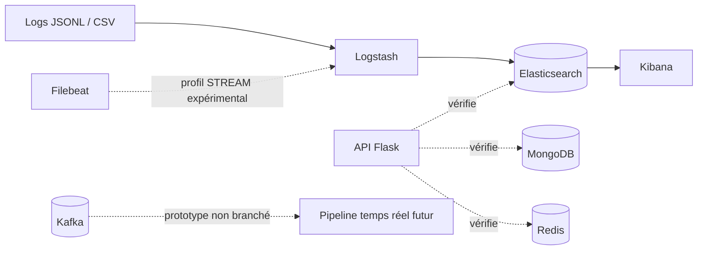

# CampusGuard — Sentinel

CampusGuard est un **mini-SIEM/SOAR explicable** conçu pour centraliser, normaliser et explorer des journaux de sécurité dans un environnement académique local. Le projet vise à aider un analyste SOC à rechercher des événements, comprendre une activité suspecte et, à terme, gérer des alertes et des réponses réversibles.

Le dépôt contient actuellement un **socle CORE validé localement** : infrastructure Docker, ingestion de données synthétiques, indexation, contrôles de santé et exploration dans Kibana. Cette validation ne couvre pas encore le MVP web complet et ne constitue pas une configuration de production.

## Fonctionnalités disponibles

- génération déterministe de journaux synthétiques d’authentification et de pare-feu en JSONL et CSV ;
- ingestion et normalisation avec Logstash ;
- indexation dans Elasticsearch avec un mapping proche d’ECS et `dynamic: false` ; les champs inconnus restent dans `_source`, mais ne sont ni indexés ni recherchables comme champs ;
- exploration des événements dans Kibana Discover avec une data view `logs-*` ;
- MongoDB et Redis opérationnels et vérifiés par l’API Flask ;
- API Flask minimale avec les routes `/`, `/health` et `/ready` ;
- sorties de rejet distinctes configurées pour CSV et JSON, avec le cas JSON invalide vérifié de bout en bout ;
- adaptateurs expérimentaux Redis Streams/Pub/Sub et Kafka ;
- tests du socle Python, de la disponibilité, du mapping, du simulateur et des bus.

## Validation CORE du 31 octobre 2026

La branche de travail `feat/core-infrastructure` a été validée avec Docker 28.4 et Docker Compose 2.39.4 :

- Elasticsearch, Logstash et Kibana 8.19.10, MongoDB 7.0, Redis 7.4 et Flask sont sains ; les initialiseurs Elasticsearch et Kibana se terminent avec le code 0 ;
- `/ready` répond HTTP 200 avec Elasticsearch, MongoDB et Redis à `ok` ; pour Elasticsearch, il exige un cluster `yellow` ou `green` et une réponse sans expiration (`timed_out: false`) ;
- les 8 contrôles de `scripts/verify_core.py` passent ;
- `logs-auth-*` contient 100 événements et `logs-firewall-*` en contient 100 ;
- la data view `logs-*` est créée et les 200 événements sont consultables dans Discover ;
- un JSON syntaxiquement invalide est détourné vers `datasets/rejected/json-dead-letter.jsonl` ; les types invalides testés pour `message`, `labels` et `source.geo` reçoivent `_invalid_field_type`, partent en dead-letter et produisent 0 document Elasticsearch ; toute exception du filtre Ruby suit également ce chemin de rejet ;
- `python -m pytest -q` passe avec 21 tests ;
- CORE consomme environ 2,21 GiB de RAM conteneurisée. L’hôte utilisait 89,0 % de ses 13,88 GiB, avec 1,53 GiB disponible : le profil STREAM n’a pas été lancé et Kafka reste interdit pour l’instant.

Voir la [preuve de validation CORE destinée au dépôt](docs/evidence/CORE_VALIDATION_2026-10-31.md) et la [capture Kibana Discover](docs/evidence/core-kibana-discover.png).

## Architecture



Le chemin opérationnel visé pour le socle CORE est :

```text
fichiers de logs → Logstash → Elasticsearch → Kibana
```

Kafka et Filebeat appartiennent au profil optionnel `stream`. Ils sont fournis comme base d’expérimentation et ne sont pas encore intégrés de bout en bout au pipeline applicatif.

## Versions CORE validées

- Docker 28.4 et Docker Compose 2.39.4 ;
- Python 3.11, Flask 3 et Gunicorn ;
- Elasticsearch, Logstash et Kibana 8.19.10 ;
- MongoDB 7.0 ;
- Redis 7.4 ;
- pytest, avec 21 tests passants lors de la validation CORE.

Le Compose déclare Kafka 3.9.1 et Filebeat 8.19.10 dans le profil expérimental. Sa configuration est syntaxiquement valide, mais ces deux services n’ont pas été lancés ni validés à l’exécution.

## Organisation du dépôt

```text
app/                 API Flask et image Docker
bus/                 adaptateurs Redis et Kafka
datasets/samples/    événements synthétiques de démonstration
docs/                analyse, architecture, données, UX et ADR
ingestion/           template Elasticsearch et pipelines Logstash/Filebeat
scripts/             initialisation, mesure mémoire et préparation des données
simulator/           générateur de logs synthétiques
tests/               tests du socle
docker-compose.yml   stack CORE et profil STREAM
```

## Prérequis

- Docker Desktop ou Docker Engine avec Compose v2 ;
- Python 3.11 ou une version compatible ;
- PowerShell sous Windows pour le rapport `scripts/feasibility.ps1` ; Bash, Git Bash ou WSL restent utiles pour les autres scripts `.sh` ;
- `curl` ;
- une mémoire suffisante pour la stack Elastic. Sur une machine de 12 Go de RAM, lancer d’abord CORE et surveiller la consommation avant d’activer Kafka.

## Démarrage rapide

```powershell
git clone https://github.com/syrinemrf/CampusGuard.git
cd CampusGuard

Copy-Item .env.example .env
python simulator/generate.py
docker compose config -q
docker compose up -d --build --wait --wait-timeout 600
python scripts/verify_core.py --wait-timeout 300
.\scripts\feasibility.ps1
```

Les fichiers de démonstration doivent être générés **avant le premier démarrage de Logstash**. Les pipelines surveillent `datasets/samples/auth.jsonl` et `datasets/samples/firewall.csv`.

Les positions de lecture ne sont pas stockées dans `/tmp` : `auth.sincedb` et `firewall.sincedb` résident dans `/usr/share/logstash/data`, sauvegardé par le volume nommé `logstash-data`. Recréer seulement le conteneur Logstash ne réinitialise donc pas la lecture. Les deux entrées fichier utilisent `mode => "read"` et `file_completed_action => "log"` : Logstash journalise la fin de lecture sans supprimer `auth.jsonl` ni `firewall.csv`. La suppression des volumes n’est pas une opération normale de redémarrage.

Pour arrêter la stack tout en conservant Elasticsearch, MongoDB, Redis et les positions Logstash :

```powershell
docker compose down
```

Ne pas ajouter `-v`, sauf réinitialisation volontaire et destructive de toutes les données persistantes du projet.

### Conflit de port Elasticsearch

Elasticsearch est publié par défaut sur `127.0.0.1:9200`. Le port hôte est configurable avec `ELASTICSEARCH_PORT`, sans modifier le port interne `elasticsearch:9200` utilisé entre conteneurs.

La validation du 31 octobre a utilisé le port 9201, car un Elasticsearch WSL 8.19.23 sécurisé occupait déjà 9200 :

```powershell
$env:ELASTICSEARCH_PORT = "9201"
docker compose up -d --build --wait --wait-timeout 600
python scripts/verify_core.py `
  --elasticsearch-url http://127.0.0.1:9201 `
  --wait-timeout 300
```

## Vérifier la stack

```powershell
docker compose ps --all
Invoke-RestMethod http://127.0.0.1:8000/health
Invoke-RestMethod http://127.0.0.1:8000/ready
python scripts/verify_core.py --wait-timeout 300
.\scripts\feasibility.ps1
```

Services accessibles localement :

- API Flask : `http://127.0.0.1:8000` ;
- Kibana : `http://127.0.0.1:5601` ;
- Elasticsearch : `http://127.0.0.1:9200` par défaut, ou le port défini par `ELASTICSEARCH_PORT`.

L’initialiseur Kibana crée automatiquement la data view `logs-*` avec `@timestamp` comme champ temporel. Ouvrir **Discover** pour consulter les événements ingérés.

Le script PowerShell de faisabilité limite `docker stats` aux conteneurs du projet et enregistre aussi la mémoire physique de l’hôte dans `reports/`.

## Exécuter les tests

```powershell
python -m venv .venv
.\.venv\Scripts\Activate.ps1
pip install -r requirements-dev.txt
python -m pytest -q
python -m compileall -q app bus simulator
```

Les tests du générateur utilisent des répertoires temporaires et ne remplacent pas les échantillons suivis par Git.

## Profil STREAM expérimental

La syntaxe du profil STREAM est validée sans démarrer ses services :

```bash
docker compose --profile stream config -q
```

Le service Filebeat attend un fichier `datasets/samples/stream-auth.jsonl`. Aucun producteur ou consommateur Kafka applicatif n’est encore relié au flux principal. Compte tenu des 89,0 % de RAM hôte mesurés avec CORE, **ne pas lancer Kafka pour l’instant**.

## Données et sécurité

Le générateur produit des données entièrement synthétiques dans `datasets/samples/`. Elles utilisent des adresses réservées à la documentation par la RFC 5737 et ne contiennent pas d’identifiants réels.

Un échantillon OpenSSH public peut être téléchargé, pseudonymisé et converti séparément :

```bash
python scripts/prepare_openssh.py --download --limit 2000
```

Cette configuration est réservée à un **laboratoire local** : Elasticsearch fonctionne sans authentification et les ports de développement sont liés à `127.0.0.1`. Ils ne doivent pas être exposés sur Internet.

## Limites actuelles et suite du projet

Le socle CORE validé ne fournit pas encore :

- l’interface métier complète ;
- l’authentification et le contrôle d’accès par rôle ;
- l’import de fichiers depuis l’interface ;
- la recherche et l’export applicatifs ;
- le moteur d’alertes, le machine learning ou les notifications temps réel ;
- les actions SOAR de blocage et de déblocage ;
- les trois visualisations de sécurité et le dashboard Kibana exporté exigés pour le MVP ;
- un pipeline Kafka opérationnel de bout en bout.

Ces fonctions sont prévues dans les phases suivantes. L’état courant et les éléments non testés sont suivis dans [`PROJECT_STATE.md`](PROJECT_STATE.md).

## Documentation

- [Analyse fonctionnelle](docs/ANALYSE_FONCTIONNELLE.md)
- [Architecture détaillée](docs/ARCHITECTURE.md)
- [Stratégie des données de sécurité](docs/DONNEES_SECURITE.md)
- [Parcours utilisateur](docs/USER_JOURNEY.md)
- [Planification S1](docs/PLANIFICATION_S1.md)
- [Revue S1](docs/REVUE_S1.md)
- [Décisions d’architecture](docs/adr/)
- [Validation CORE du 31 octobre 2026](docs/evidence/CORE_VALIDATION_2026-10-31.md)
- [Capture Kibana Discover](docs/evidence/core-kibana-discover.png)

## Auteure

Projet académique développé par **Syrine Maaref** ([@syrinemrf](https://github.com/syrinemrf)) à l’ITBS, sous l’encadrement de **Mohamed Najeh Issaoui**.
