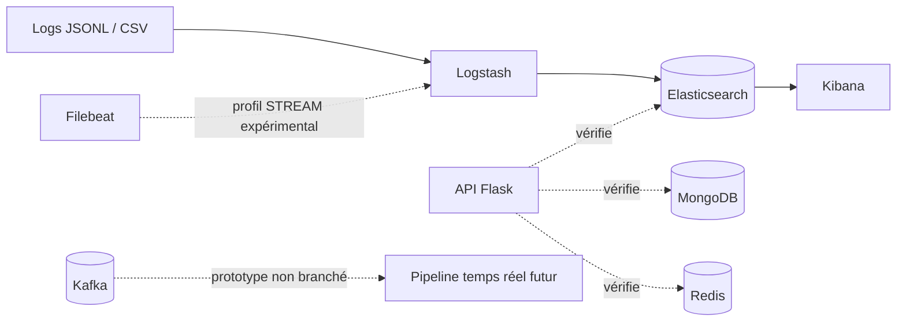

# CampusGuard — Sentinel

CampusGuard est un **mini-SIEM/SOAR explicable** conçu pour centraliser, normaliser et explorer des journaux de sécurité dans un environnement académique local. Le projet vise à aider un analyste SOC à rechercher des événements, comprendre une activité suspecte et, à terme, gérer des alertes et des réponses réversibles.

Le dépôt contient actuellement les **fondations S1** du projet : l’infrastructure Docker, l’ingestion de données synthétiques, le stockage, les contrôles de santé et la documentation d’architecture. Il ne s’agit pas encore d’un produit prêt pour la production.

## Fonctionnalités disponibles

- génération déterministe de journaux synthétiques d’authentification et de pare-feu en JSONL et CSV ;
- ingestion et normalisation avec Logstash ;
- indexation dans Elasticsearch avec un mapping proche d’ECS ;
- exploration des événements dans Kibana ;
- stockage prévu avec MongoDB et état rapide avec Redis ;
- API Flask minimale avec les routes `/`, `/health` et `/ready` ;
- fichiers de rejet pour les événements CSV ou JSON invalides ;
- adaptateurs expérimentaux Redis Streams/Pub/Sub et Kafka ;
- tests unitaires du socle Python, du mapping, du simulateur et des bus.

## Architecture



Le chemin opérationnel visé pour le socle CORE est :

```text
fichiers de logs → Logstash → Elasticsearch → Kibana
```

Kafka et Filebeat appartiennent au profil optionnel `stream`. Ils sont fournis comme base d’expérimentation et ne sont pas encore intégrés de bout en bout au pipeline applicatif.

## Technologies

- Python 3.11, Flask et Gunicorn ;
- Elasticsearch, Logstash et Kibana 8.x ;
- MongoDB 7 ;
- Redis 7 ;
- Kafka 3.9 et Filebeat pour le profil expérimental ;
- Docker Compose v2 ;
- pytest.

## Organisation du dépôt

```text
app/                 API Flask et image Docker
bus/                 adaptateurs Redis et Kafka
datasets/samples/    événements synthétiques de démonstration
docs/                analyse, architecture, données, UX et ADR
ingestion/           template Elasticsearch et pipelines Logstash/Filebeat
scripts/             initialisation, mesure mémoire et préparation des données
simulator/           générateur de logs synthétiques
tests/               tests du socle
docker-compose.yml   stack CORE et profil STREAM
```

## Prérequis

- Docker Desktop ou Docker Engine avec Compose v2 ;
- Python 3.11 ou une version compatible ;
- Bash, Git Bash ou WSL sous Windows pour les scripts `.sh` ; le relevé mémoire `feasibility.sh` nécessite Linux ou WSL ;
- `curl` ;
- une mémoire suffisante pour la stack Elastic. Sur une machine de 12 Go de RAM, lancer d’abord CORE et surveiller la consommation avant d’activer Kafka.

## Démarrage rapide

```bash
git clone https://github.com/syrinemrf/CampusGuard.git
cd CampusGuard

cp .env.example .env
python simulator/generate.py
mkdir -p datasets/rejected

# Démarrer les dépendances persistantes
docker compose up -d --wait elasticsearch mongodb redis

# Attendre qu’Elasticsearch soit disponible, puis installer le template
curl -f http://localhost:9200
bash scripts/setup-index.sh

# Démarrer l’ingestion, Kibana et l’API
docker compose up -d --build logstash kibana webapp
docker compose ps
```

Les fichiers de démonstration doivent être générés **avant** le démarrage de Logstash. Les pipelines surveillent les chemins fixes `datasets/samples/auth.jsonl` et `datasets/samples/firewall.csv`. Pour rejouer ces fichiers, il faut les régénérer puis recréer le conteneur Logstash afin de réinitialiser son `sincedb` stocké dans `/tmp`.

## Vérifier la stack

```bash
curl -f http://localhost:8000/health
curl -f http://localhost:8000/ready
curl -s "http://localhost:9200/logs-*/_count?ignore_unavailable=true"
```

Services accessibles localement :

- API Flask : `http://localhost:8000` ;
- Kibana : `http://localhost:5601` ;
- Elasticsearch : `http://localhost:9200`.

Dans Kibana, créer une vue de données `logs-*` avec `@timestamp` comme champ temporel, puis ouvrir **Discover** pour consulter les événements ingérés.

Pour relever la consommation réelle de la stack :

```bash
bash scripts/feasibility.sh
```

## Exécuter les tests

```bash
python -m venv .venv

# Linux, macOS ou WSL
source .venv/bin/activate

# Windows PowerShell : .\.venv\Scripts\Activate.ps1

pip install -r app/requirements.txt pytest
python -m pytest -q
# Le test du générateur écrit 40 événements dans les samples suivis par Git.
# Restaurer ensuite les fichiers de démonstration canoniques (100 événements).
python simulator/generate.py
python -m compileall -q app bus simulator
```

## Profil STREAM expérimental

Activer Kafka uniquement après avoir validé la stack CORE et sa consommation mémoire :

```bash
docker compose --profile stream up -d --wait kafka
bash scripts/kafka-init-topics.sh
docker compose exec kafka /opt/kafka/bin/kafka-topics.sh \
  --bootstrap-server kafka:9092 --list
```

Le service Filebeat attend un fichier `datasets/samples/stream-auth.jsonl`. Aucun producteur ou consommateur Kafka applicatif n’est encore relié au flux principal.

## Données et sécurité

Les données versionnées dans `datasets/samples/` sont entièrement synthétiques. Elles utilisent des adresses réservées à la documentation par la RFC 5737 et ne contiennent pas d’identifiants réels.

Un échantillon OpenSSH public peut être téléchargé, pseudonymisé et converti séparément :

```bash
python scripts/prepare_openssh.py --download --limit 2000
```

Cette configuration est réservée à un **laboratoire local** : Elasticsearch fonctionne sans authentification et les ports de développement sont liés à `127.0.0.1`. Ils ne doivent pas être exposés sur Internet.

## Limites actuelles et suite du projet

La phase S1 ne fournit pas encore :

- l’interface métier complète ;
- l’authentification et le contrôle d’accès par rôle ;
- l’import de fichiers depuis l’interface ;
- la recherche et l’export applicatifs ;
- le moteur d’alertes, le machine learning ou les notifications temps réel ;
- les actions SOAR de blocage et de déblocage ;
- un pipeline Kafka opérationnel de bout en bout.

Ces fonctions sont prévues dans les phases suivantes. [`PROJECT_STATE.md`](PROJECT_STATE.md) conserve l’instantané de la revue S1 du 30 octobre 2026 ; ses références à Git et GitHub décrivent la situation au moment de cette revue, avant la publication du dépôt actuel.

## Documentation

- [Analyse fonctionnelle](docs/ANALYSE_FONCTIONNELLE.md)
- [Architecture détaillée](docs/ARCHITECTURE.md)
- [Stratégie des données de sécurité](docs/DONNEES_SECURITE.md)
- [Parcours utilisateur](docs/USER_JOURNEY.md)
- [Planification S1](docs/PLANIFICATION_S1.md)
- [Revue S1](docs/REVUE_S1.md)
- [Décisions d’architecture](docs/adr/)

## Auteure

Projet académique développé par **Syrine Maaref** ([@syrinemrf](https://github.com/syrinemrf)) à l’ITBS, sous l’encadrement de **Mohamed Najeh Issaoui**.
