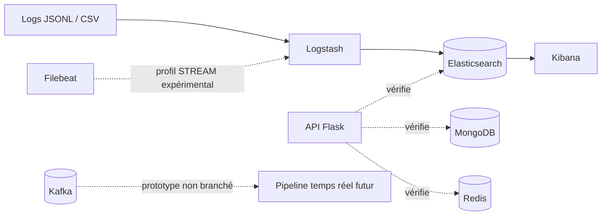

# CampusGuard — Sentinel

CampusGuard est un **mini-SIEM/SOAR explicable** conçu pour centraliser, normaliser et explorer des journaux de sécurité dans un environnement académique local. Le projet vise à aider un analyste SOC à rechercher des événements, comprendre une activité suspecte et, à terme, gérer des alertes et des réponses réversibles.

Le dépôt contient le **socle obligatoire complet** (S1 à S3 : infrastructure Docker, ingestion, authentification par rôles, upload CSV/JSON/TXT, recherche, export, API + Swagger, centre de pilotage et dashboard Kibana d’analyse) le **module avancé G — alerting** avec une réponse **SOAR-lite** (S4 : règles, worker séparé, notifications e-mail/webhook, incidents, blocage d’IP local à durée limitée), le **module H — temps réel** (S5 : journal sshd réel rejoué, Filebeat → Kafka → Logstash, WebSocket, live tail, métriques et latence mesurées, escalade, mise en veille, rapport PDF mensuel de conformité) et les **expériences ML/NLP** (S6 : règles vs Isolation Forest, TF-IDF vs MiniLM, Isolation Forest intégré au worker ; tests de charge, de sécurité et de reprise). Tout est validé sur la stack Docker réelle : `verify_core` 8/8, `verify_s2` 18/18, `verify_s3` 13/13 et `verify_s4` 21/21 (13 novembre 2026, preuves dans `docs/evidence/`). État détaillé et honnête : [`PROJECT_STATE.md`](PROJECT_STATE.md). Ce n’est pas une configuration de production.

## Fonctionnalités disponibles

- génération déterministe de journaux synthétiques d’authentification et de pare-feu en JSONL et CSV ;
- ingestion et normalisation avec Logstash ;
- indexation dans Elasticsearch avec un mapping proche d’ECS et `dynamic: false` ; les champs inconnus restent dans `_source`, mais ne sont ni indexés ni recherchables comme champs ;
- exploration des événements dans Kibana Discover avec une data view `logs-*` ;
- MongoDB et Redis opérationnels et vérifiés par l’API Flask ;
- **S2** : connexion avec rôles (Administrateur, Analyste SOC, Auditeur), sessions Redis, upload CSV/JSON/JSONL/TXT avec aperçu de 10 lignes et validation, ingestion Logstash, statut reçu → validé → indexé mesuré dans Elasticsearch, recherche multicritère paginée, détail d’événement, export CSV, historique de recherche MongoDB (détails dans la section « S2 » ci-dessous) ;
- routes de santé `/health` et `/ready` ;
- sorties de rejet distinctes configurées pour CSV et JSON, avec le cas JSON invalide vérifié de bout en bout ;
- adaptateurs expérimentaux Redis Streams/Pub/Sub et Kafka ;
- **S3** : deux tableaux de bord complémentaires — le **centre de pilotage** (accueil : KPI comparés à la période précédente, alertes à traiter, IP prioritaires, santé mesurée des services, pipelines Logstash, fraîcheur et rejets) et l’**analyse dans Kibana**, organisée en 3 tableaux de bord thématiques au format paysage (vue d’ensemble, menaces sur l’authentification, alertes : part des échecs, carte de chaleur heure × jour, comptes visés, pays, services attaqués, alertes par gravité et par règle) exporté en NDJSON dans `ingestion/kibana/`, ré-importable et intégré dans l’application ; fenêtre modale de détail, page 404, fil d’Ariane, version mobile ; préférences par utilisateur (MongoDB) ; documents d’[analyse fonctionnelle](docs/ANALYSE_FONCTIONNELLE.pdf) et d’[architecture technique](docs/ARCHITECTURE.pdf) ;
- **S4** : 8 règles de détection du scénario C (force brute, credential stuffing, pays non autorisé, hors horaires, élévation de privilèges, injection SQL, pic d’erreurs, silence), éditeur avec **test avant activation**, worker d’alertes séparé, *silencing* et *cooldown*, notifications e-mail (Mailpit) et webhook (Slack/Discord/Teams/JSON) avec *retry*, prise en compte / résolution / MTTR, **blocage d’IP local** avec durée de vie et audit (détails dans la section « S4 ») ;
- **S5** : flux continu sur le **journal sshd réel** de Loghub (pseudonymisé en gardant le pays), Filebeat → Kafka → Logstash → Elasticsearch → Redis Pub/Sub → **WebSocket** ; page **Flux en direct** (tail -f filtrable, pause, tampon de 500 lignes, reconnexion automatique, logs/s, erreurs/min, latence médiane et p95, requêtes en cours, utilisateurs connectés) ; page **Sources & chaîne** (état mesuré de chaque maillon) ; **escalade** N2/N3, **mise en veille**, commentaires d’incident ; **rapport mensuel de conformité** en PDF ;
- **S6** : expériences reproductibles ([résultats](docs/experiments/S6_EXPERIENCES.md)) et règle « Comportement SSH anormal » (Isolation Forest, causes probables, sans blocage) ; scripts de tests de charge (Locust, 100 utilisateurs), de sécurité et de reprise ;
- 311 tests automatisés.

## Validation CORE du 31 octobre 2026

La branche de travail `feat/core-infrastructure` a été validée avec Docker 28.4 et Docker Compose 2.39.4 :

- Elasticsearch, Logstash et Kibana 8.19.10, MongoDB 7.0, Redis 7.4 et Flask sont sains ; les initialiseurs Elasticsearch et Kibana se terminent avec le code 0 ;
- `/ready` répond HTTP 200 avec Elasticsearch, MongoDB et Redis à `ok` ; pour Elasticsearch, il exige un cluster `yellow` ou `green` et une réponse sans expiration (`timed_out: false`) ;
- les 8 contrôles de `scripts/verify_core.py` passent ;
- `logs-auth-*` contient 100 événements et `logs-firewall-*` en contient 100 ;
- la data view `logs-*` est créée et les 200 événements sont consultables dans Discover ;
- un JSON syntaxiquement invalide est détourné vers `datasets/rejected/json-dead-letter.jsonl` ; les types invalides testés pour `message`, `labels` et `source.geo` reçoivent `_invalid_field_type`, partent en dead-letter et produisent 0 document Elasticsearch ; toute exception du filtre Ruby suit également ce chemin de rejet ;
- `python -m pytest -q` passe avec 21 tests ;
- CORE consomme environ 2,21 GiB de RAM conteneurisée. L’hôte utilisait 89,0 % de ses 13,88 GiB, avec 1,53 GiB disponible : le profil STREAM n’a pas été lancé et Kafka reste interdit pour l’instant.

Voir la [preuve de validation CORE destinée au dépôt](docs/evidence/CORE_VALIDATION_2026-10-31.md) et la [capture Kibana Discover](docs/evidence/core-kibana-discover.png).

## S2 — Authentification, upload, ingestion et recherche

### Démarrer et créer les comptes

```powershell
docker compose up -d --build --wait --wait-timeout 600
docker compose exec webapp flask --app app.main seed-users
```

La commande crée `admin`, `analyste` et `auditeur` s’ils n’existent pas. Les mots de passe viennent de `SEED_ADMIN_PASSWORD`, `SEED_ANALYST_PASSWORD`, `SEED_AUDITOR_PASSWORD` (12 caractères minimum, à placer dans `.env`, jamais dans Git) ; sinon un mot de passe aléatoire est **affiché une seule fois**. Autre compte : `docker compose exec webapp flask --app app.main create-user <nom> <admin|analyst|auditor>`. Mot de passe perdu : `docker compose exec webapp flask --app app.main set-password <nom>` (audité).

Ouvrir `http://127.0.0.1:8000`. Droits : l’**Administrateur** et l’**Analyste** envoient des fichiers (l’analyste ne voit que les siens) ; l’**Auditeur** consulte les imports et recherche en lecture seule.

### Parcours d’import

1. **Envoi de fichiers** : choisir ou déposer un fichier `.csv`, `.json`, `.jsonl`, `.ndjson`, `.txt` ou `.log` (10 Mo max, `MAX_UPLOAD_MB`).
2. L’application vérifie l’extension, le type MIME, l’absence de contenu binaire, l’encodage UTF-8, calcule le SHA-256 (un fichier identique est refusé) et valide chaque ligne. Elle affiche les **10 premières lignes**, les événements normalisés et les erreurs avec leur numéro de ligne.
3. **Lancer l’ingestion** : le fichier normalisé est déposé dans le volume surveillé par le pipeline Logstash `upload-security`.
4. L’état passe à **Indexé** (ou **Partiellement indexé** / **Échec**) uniquement après comptage dans Elasticsearch et dans le fichier de rejets `datasets/rejected/upload-<id>.ndjson`.

Formats attendus : CSV avec en-tête contenant un horodatage (`timestamp`, `time`, `date`…) et une IP (`ip`, `source_ip`…) ; colonnes optionnelles `user`, `outcome`, `level`, `action`, `service`, `port`, `message`. JSON/JSONL : objets avec les mêmes champs (plats ou ECS imbriqués). TXT : une ligne = un événement ; horodatage ISO ou syslog reconnu, IP extraite, motifs `sshd` simples (heuristiques).

### Valider S2 sur la stack réelle

```powershell
python scripts/verify_s2.py --base-url http://127.0.0.1:8000 --username analyste --password "<mot de passe>" --evidence docs/evidence/s2-verify-result.json
```

Le script envoie un vrai fichier, le fait passer par Logstash et Elasticsearch, puis contrôle statut, recherche, filtres, export et détail (18 contrôles). Sans lui, l’ingestion des uploads reste **non vérifiée**.

### API

Spécification OpenAPI : `/api/openapi.json` ; documentation interactive Swagger UI : `http://127.0.0.1:8000/api/docs` (après connexion). Détails, routes et codes d’erreur : [docs/API.md](docs/API.md) (authentification par session + en-tête `X-CSRF-Token`, limite 300 requêtes/min).

## S4 — Alertes, incidents et blocage d’IP

```powershell
docker compose up -d --build --wait --wait-timeout 600     # démarre aussi alert-worker et mailpit
python scripts/simulate_attack.py                          # scénario d'attaque synthétique, horodaté maintenant
```

- `http://127.0.0.1:8000/alerts` : alertes actives (prise en compte, résolution avec note), alertes par jour, top 10, MTTR, IP bloquées ;
- `http://127.0.0.1:8000/alerts/rules` : règles, éditeur (requête Elasticsearch `query_string`) et **test avant activation** ;
- `http://127.0.0.1:8025` : boîte e-mail de laboratoire (Mailpit) où arrivent les alertes avec leur graphique.

Le worker (`alert-worker`) évalue les règles actives toutes les 30 s. Une même attaque reste **une seule alerte** tant qu’elle est ouverte ; un *cooldown* évite de ré-alerter juste après une résolution. La règle « force brute » bloque l’IP source **dans l’application uniquement** (HTTP 403) pendant 15 min ; aucune action réseau. Débloquer : bouton « Débloquer » (administrateur) ou `docker compose exec webapp flask --app app.main unblock-ip <ip>`.

Validation de bout en bout sur la stack réelle (attaque → Logstash → Elasticsearch → worker → alerte → e-mail + webhook → blocage → résolution → MTTR) :

```powershell
python scripts/verify_s4.py --username admin --password "<mot de passe admin>" --evidence docs/evidence/verify_s4.json
```

Option `--self-block` : attaque la page de connexion de l’application depuis votre machine pour prouver l’auto-protection (votre machine est bloquée puis débloquée automatiquement).

## Architecture



Le chemin opérationnel visé pour le socle CORE est :

```text
fichiers de logs → Logstash → Elasticsearch → Kibana
```

Kafka et Filebeat appartiennent au profil optionnel `stream`. Ils sont fournis comme base d’expérimentation et ne sont pas encore intégrés de bout en bout au pipeline applicatif.

## Versions CORE validées

- Docker 28.4 et Docker Compose 2.39.4 ;
- Python 3.11, Flask 3 et Gunicorn ;
- Elasticsearch, Logstash et Kibana 8.19.10 ;
- MongoDB 7.0 ;
- Redis 7.4 ;
- pytest, avec 21 tests passants lors de la validation CORE.

Le Compose déclare Kafka 3.9.1 et Filebeat 8.19.10 dans le profil expérimental. Sa configuration est syntaxiquement valide, mais ces deux services n’ont pas été lancés ni validés à l’exécution.

## Organisation du dépôt

```text
app/                 API Flask et image Docker
bus/                 adaptateurs Redis et Kafka
datasets/samples/    événements synthétiques de démonstration
docs/                analyse, architecture, données, UX et ADR
ingestion/           template Elasticsearch et pipelines Logstash/Filebeat
scripts/             initialisation, mesure mémoire et préparation des données
simulator/           générateur de logs synthétiques
tests/               tests du socle
docker-compose.yml   stack CORE et profil STREAM
```

## Prérequis

- Docker Desktop ou Docker Engine avec Compose v2 ;
- Python 3.11 ou une version compatible ;
- PowerShell sous Windows pour le rapport `scripts/feasibility.ps1` ; Bash, Git Bash ou WSL restent utiles pour les autres scripts `.sh` ;
- `curl` ;
- une mémoire suffisante pour la stack Elastic. Sur une machine de 12 Go de RAM, lancer d’abord CORE et surveiller la consommation avant d’activer Kafka.

## Démarrage rapide

```powershell
git clone https://github.com/syrinemrf/CampusGuard.git
cd CampusGuard

Copy-Item .env.example .env
python simulator/generate.py
docker compose config -q
docker compose up -d --build --wait --wait-timeout 600
python scripts/verify_core.py --wait-timeout 300
.\scripts\feasibility.ps1
```

Les fichiers de démonstration doivent être générés **avant le premier démarrage de Logstash**. Les pipelines surveillent `datasets/samples/auth.jsonl` et `datasets/samples/firewall.csv`.

Les positions de lecture ne sont pas stockées dans `/tmp` : `auth.sincedb` et `firewall.sincedb` résident dans `/usr/share/logstash/data`, sauvegardé par le volume nommé `logstash-data`. Recréer seulement le conteneur Logstash ne réinitialise donc pas la lecture. Les deux entrées fichier utilisent `mode => "read"` et `file_completed_action => "log"` : Logstash journalise la fin de lecture sans supprimer `auth.jsonl` ni `firewall.csv`. La suppression des volumes n’est pas une opération normale de redémarrage.

Pour arrêter la stack tout en conservant Elasticsearch, MongoDB, Redis et les positions Logstash :

```powershell
docker compose down
```

Ne pas ajouter `-v`, sauf réinitialisation volontaire et destructive de toutes les données persistantes du projet.

### Conflit de port Elasticsearch

Elasticsearch est publié par défaut sur `127.0.0.1:9200`. Le port hôte est configurable avec `ELASTICSEARCH_PORT`, sans modifier le port interne `elasticsearch:9200` utilisé entre conteneurs.

La validation du 31 octobre a utilisé le port 9201, car un Elasticsearch WSL 8.19.23 sécurisé occupait déjà 9200 :

```powershell
$env:ELASTICSEARCH_PORT = "9201"
docker compose up -d --build --wait --wait-timeout 600
python scripts/verify_core.py `
  --elasticsearch-url http://127.0.0.1:9201 `
  --wait-timeout 300
```

## Vérifier la stack

```powershell
docker compose ps --all
Invoke-RestMethod http://127.0.0.1:8000/health
Invoke-RestMethod http://127.0.0.1:8000/ready
python scripts/verify_core.py --wait-timeout 300
.\scripts\feasibility.ps1
```

Services accessibles localement :

- API Flask : `http://127.0.0.1:8000` ;
- Kibana : `http://127.0.0.1:5601` ;
- Elasticsearch : `http://127.0.0.1:9200` par défaut, ou le port défini par `ELASTICSEARCH_PORT`.

L’initialiseur Kibana crée automatiquement la data view `logs-*` avec `@timestamp` comme champ temporel. Ouvrir **Discover** pour consulter les événements ingérés.

Le script PowerShell de faisabilité limite `docker stats` aux conteneurs du projet et enregistre aussi la mémoire physique de l’hôte dans `reports/`.

## Exécuter les tests

```powershell
python -m venv .venv
.\.venv\Scripts\Activate.ps1
pip install -r requirements-dev.txt
python -m pytest -q
python -m compileall -q app bus simulator
```

Les tests du générateur utilisent des répertoires temporaires et ne remplacent pas les échantillons suivis par Git.

## S5 — Temps réel

```powershell
docker compose up -d --build                         # stack principale (Logstash écoute aussi en TCP 5140)
docker compose --profile stream up -d                # + Kafka (topic créé automatiquement) et Filebeat
python scripts/replay_openssh.py --download          # rejoue le journal sshd réel (~4 h en 4 min)
python scripts/replay_openssh.py --to tcp            # même chose sans Kafka
```

- `http://127.0.0.1:8000/live` : flux en direct, métriques, alertes au moment où elles sont levées ;
- `http://127.0.0.1:8000/sources` : état de chaque maillon (Filebeat, Kafka, Logstash, Elasticsearch, Redis) et latence ;
- `http://127.0.0.1:8000/reports` : rapport mensuel de conformité, aperçu et PDF.

Validation : `python scripts/verify_s5.py --password "<analyste>" --admin-password "<admin>" --evidence`.

## S6 — Expériences et tests

```powershell
pip install -r requirements-ml.txt
python experiments/run_s6.py                                     # résultats dans docs/experiments/
python scripts/security_check.py --analyst-password "..." --auditor-password "..." --rate --evidence
python scripts/recovery_check.py --password "..." --kafka --evidence
pip install locust==2.37.10
locust -f tests/perf/locustfile.py --host http://localhost:8000 --headless -u 100 -r 10 -t 3m --csv docs/evidence/load --html docs/evidence/load_report.html
```

Pour le test de charge, relancer la webapp avec `API_RATE_LIMIT_PER_MIN=0` (sinon on mesure le limiteur de débit).

## Données et sécurité

Le générateur produit des données entièrement synthétiques dans `datasets/samples/`. Elles utilisent des adresses réservées à la documentation par la RFC 5737 et ne contiennent pas d’identifiants réels.

Un échantillon OpenSSH public peut être téléchargé, pseudonymisé et converti séparément :

```bash
python scripts/prepare_openssh.py --download --limit 2000
```

Pseudonymisation des IP : les deux premiers octets sont conservés (le pays et l’opérateur restent justes pour la GeoIP), les deux derniers sont remplacés par un hachage stable ; les comptes qui se sont réellement connectés sont renommés.

Cette configuration est réservée à un **laboratoire local** : Elasticsearch fonctionne sans authentification et les ports de développement sont liés à `127.0.0.1`. Ils ne doivent pas être exposés sur Internet.

## Limites actuelles et suite du projet

- trafic légitime simulé dans les expériences S6 (le journal Loghub ne contient presque que des attaques) ;
- MiniLM évalué mais non intégré (aucun gain sur des logs sshd) ;
- gestion des utilisateurs par la CLI uniquement ;
- S7 : recette finale, installation sur une autre machine, rapport, slides et vidéo.

L’état courant et les éléments non testés sont suivis dans [`PROJECT_STATE.md`](PROJECT_STATE.md).

## Documentation

- [Analyse fonctionnelle](docs/ANALYSE_FONCTIONNELLE.md)
- [Architecture détaillée](docs/ARCHITECTURE.md)
- [Stratégie des données de sécurité](docs/DONNEES_SECURITE.md)
- [Parcours utilisateur](docs/USER_JOURNEY.md)
- [Planification S1](docs/PLANIFICATION_S1.md)
- [Revue S1](docs/REVUE_S1.md)
- [Décisions d’architecture](docs/adr/)
- [Validation CORE du 31 octobre 2026](docs/evidence/CORE_VALIDATION_2026-10-31.md)
- [Capture Kibana Discover](docs/evidence/core-kibana-discover.png)
- [API REST S2](docs/API.md)
- [Audit de l’état au 6 novembre 2026 et validation S2](docs/evidence/AUDIT_ET_S2_2026-11-06.md)

## Auteure

Projet académique développé par **Syrine Maaref** ([@syrinemrf](https://github.com/syrinemrf)) à l’ITBS, sous l’encadrement de **Mohamed Najeh Issaoui**.
