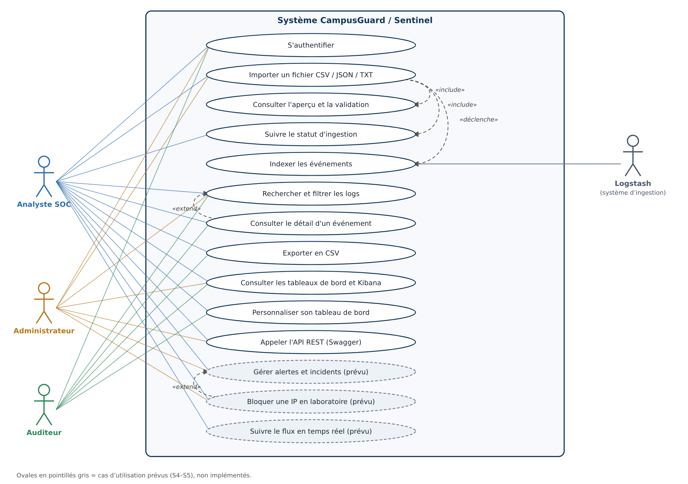

# CampusGuard / Sentinel — Analyse fonctionnelle

**Version 1.0 — 6 novembre 2026** · Auteure : Syrine Maaref (ITBS) · Encadrant : Mohamed Najeh Issaoui · Scénario C « Sécurité et authentification » du Mini-Projet ELK · Périmètre : système local de laboratoire, données fictives ou synthétiques.

> **Lecture du statut.** Chaque fonction porte un statut explicite : **Réalisé** (code et tests automatisés présents ; la vérification sur la pile Docker réelle reste à faire par l'étudiante via `scripts/verify_s2.py` / `verify_s3.py`), **Prévu** (planifié, non implémenté). Aucune fonction « Prévue » n'est présentée comme livrée.

## 1. Contexte, problématique et valeur

Un établissement, une PME ou un laboratoire produisent chaque jour des journaux d'authentification (SSH, applications web), de pare-feu et d'administration. Ils sont dispersés, hétérogènes (CSV, JSON, texte libre) et rarement relus. Quand un incident survient — répétition d'échecs de connexion depuis une même adresse, accès administrateur inhabituel — l'équipe doit reconstituer à la main la chronologie, ce qui est lent, incomplet et non traçable.

**CampusGuard / Sentinel** répond à ce besoin en trois temps : (1) *centraliser* les journaux par import contrôlé de fichiers, (2) *les rendre consultables* (recherche, filtres, détail, export, tableaux de bord Kibana et applicatif), (3) *réagir* par des alertes explicables et des actions réversibles limitées à un service de démonstration. La valeur démontrable : réduire le temps entre « un fichier de logs » et « une réponse argumentée à *que s'est-il passé, depuis qui, à quelle heure ?* », avec une traçabilité complète de ce que le système et les utilisateurs ont fait.

**Justification du scénario C.** L'authentification est le premier vecteur d'attaque observable dans des logs ; elle fournit des événements courts, structurés (`utilisateur`, `IP`, `résultat`, `heure`) et suffisamment volumineux pour justifier une pile ELK (indexation inversée, agrégations temporelles, géolocalisation). Elle permet aussi d'illustrer une règle métier simple et vérifiable (5 échecs en 5 minutes) et d'étendre vers l'alerting (module G) et le temps réel (module H).

**Hors périmètre assumé.** Pas de déploiement sur Internet, pas de modification du pare-feu du poste, pas de données personnelles réelles, pas de garantie de conformité réglementaire.

## 2. Acteurs et droits

| Acteur | Rôle applicatif | Droits | Restrictions |
|---|---|---|---|
| Administrateur | `admin` | tout ce que fait l'analyste ; (prévu) gestion des utilisateurs, règles, paramètres | toute action de réponse est journalisée |
| Analyste SOC | `analyst` | importer, confirmer ou annuler un import, rechercher, exporter, consulter Kibana ; (prévu) acquitter/escalader une alerte | pas d'administration globale |
| Auditeur | `auditor` | lecture seule : recherche, détail, export, tableaux de bord | ne peut ni importer ni modifier |
| Système d'ingestion | Logstash | transformer et indexer les événements | aucun accès à l'interface |
| Encadrant | lecteur | revue des livrables et du tableau Jira | aucune donnée sensible |

Les rôles sont **appliqués par le code** (décorateur `roles_required`, testé) ; un rôle insuffisant renvoie HTTP 403.

## 3. Diagramme de cas d'utilisation

*Notation UML simplifiée. Source : `scripts/build_usecase_diagram.py`.*

## 4. Exigences fonctionnelles et statut

| Réf. | Exigence | Module du sujet | Statut |
|---|---|---|---|
| F01 | Importer CSV / JSON / TXT avec limite de taille, contrôle de type, **aperçu des 10 premières lignes**, rapport d'erreurs par ligne | Gestion de fichiers (obligatoire) | Réalisé |
| F02 | Normaliser (UTC, ECS) et indexer via Logstash ; statut mesuré *indexé / partiel / échec* | Config. ELK (obligatoire) | Réalisé (vérif. Docker à faire) |
| F03 | Afficher les indicateurs globaux (total, aujourd'hui, erreurs, imports) | Interface (obligatoire) | Réalisé |
| F04 | Rechercher et filtrer (texte, période, niveau, service, résultat, IP/CIDR, utilisateur, import), trier, paginer | Interface (obligatoire) | Réalisé |
| F05 | Détail complet d'un événement | Interface (obligatoire) | Réalisé |
| F06 | Export CSV des résultats filtrés | Interface (obligatoire) | Réalisé |
| F07 | Historique des recherches et métadonnées de fichiers dans MongoDB | MongoDB (obligatoire) | Réalisé |
| F08 | 3 visualisations Kibana + dashboard exporté, réimportable, intégré à l'application | Kibana (obligatoire) | Réalisé (import réel à vérifier) |
| F09 | Lancement complet par Docker Compose, sans secret dans git | Docker (obligatoire) | Réalisé (vérif. à faire) |
| F10 | Refus explicites et messages d'erreur (fichier binaire, doublon, trop volumineux, paramètre invalide) | Transversal | Réalisé |
| F11 | Authentification, sessions, rôles Administrateur / Analyste / Auditeur | Intermédiaire : Auth + Rôles | Réalisé |
| F12 | Cache Redis des recherches (30 s) et limitation de débit | Intermédiaire : Cache Redis | Réalisé |
| F13 | API REST documentée OpenAPI / Swagger (`/api/docs`) | Intermédiaire : API + Swagger | Réalisé |
| F14 | Tableau de bord personnalisable par utilisateur (blocs affichés) | Intermédiaire : dashboards personnalisés | Réalisé |
| F15 | Règles d'alerte, déduplication, cooldown, acquittement, notifications | Avancé G | Prévu (S4–S5) |
| F16 | Blocage d'IP de laboratoire (TTL Redis) après 5 échecs / 5 min, avec audit | Avancé G | Prévu (S4) |
| F17 | Flux continu, live tail WebSocket, KPI en direct, reconnexion | Avancé H | Prévu (S5) |
| F18 | Rapport mensuel de sécurité exportable | Avancé G | Prévu (S5) |
| F19 | Comparaisons expérimentales règles vs Isolation Forest, TF-IDF vs MiniLM | Bonus | Prévu (S6) |

## 5. User stories priorisées

Priorité MoSCoW : **M**ust, **S**hould, **C**ould. Chaque story a des critères d'acceptation vérifiables.

| ID | User story | Prio. | Critères d'acceptation | Statut |
|---|---|---|---|---|
| US01 | **En tant qu'**utilisateur, **je veux** me connecter avec mon identifiant et mon mot de passe **afin d'**accéder uniquement aux fonctions de mon rôle. | M | Mauvais mot de passe → refus générique ; 5 échecs en 5 min → blocage temporaire ; session expirée après inactivité ; mot de passe jamais journalisé. | Réalisé |
| US02 | **En tant qu'**analyste, **je veux** déposer un fichier CSV, JSON ou TXT **afin de** le rendre interrogeable. | M | Extensions autorisées uniquement ; taille ≤ limite ; fichier binaire refusé ; doublon (même SHA-256) refusé. | Réalisé |
| US03 | **En tant qu'**analyste, **je veux** voir un aperçu des 10 premières lignes et les erreurs de validation **afin de** décider d'importer ou non. | M | Aperçu brut + événements normalisés ; erreurs avec numéro de ligne ; rejet automatique si > 50 % de lignes invalides ; confirmation explicite avant ingestion. | Réalisé |
| US04 | **En tant qu'**analyste, **je veux** suivre l'état de mon import **afin de** savoir si les logs sont réellement indexés. | M | États reçu / validé / ingestion / indexé / partiel / échec ; compte mesuré dans Elasticsearch ; indicateur « bloqué » après 300 s sans prétendre à un échec. | Réalisé (vérif. réelle à faire) |
| US05 | **En tant qu'**analyste, **je veux** rechercher par texte, période, niveau, service, résultat, IP et utilisateur **afin de** reconstituer un incident. | M | Combinaison de filtres ; résultats paginés (≤ 100 par page) ; tri par date, niveau ou service ; paramètre invalide → 400 avec détail. | Réalisé |
| US06 | **En tant qu'**analyste, **je veux** ouvrir le détail d'un événement **afin de** voir tous ses champs. | M | Tous les champs ECS affichés ; événement inconnu → 404. | Réalisé |
| US07 | **En tant qu'**auditeur, **je veux** exporter les résultats en CSV **afin de** conserver une preuve. | M | Mêmes filtres que l'écran ; plafond signalé (`X-Export-Truncated`) ; cellules protégées contre l'injection de formules ; export tracé dans l'audit. | Réalisé |
| US08 | **En tant qu'**utilisateur, **je veux** retrouver mes dernières recherches **afin de** les rejouer. | S | Les 5 dernières, par utilisateur, stockées dans MongoDB. | Réalisé |
| US09 | **En tant que** responsable sécurité, **je veux** un tableau de bord Kibana (volume dans le temps, succès/échecs, IP les plus en échec) **afin de** repérer les anomalies d'un coup d'œil. | M | 3 visualisations + 1 indicateur dans un dashboard exporté en NDJSON, réimportable, affiché dans l'application. | Réalisé (import réel à vérifier) |
| US10 | **En tant qu'**utilisateur, **je veux** choisir les blocs de mon tableau de bord **afin de** n'afficher que ce qui m'est utile. | S | Préférence enregistrée par utilisateur ; bouton « tout réafficher ». | Réalisé |
| US11 | **En tant que** développeur, **je veux** une API documentée **afin d'**automatiser les imports et recherches. | S | Spécification OpenAPI servie ; test automatique de cohérence avec les routes ; limitation de débit documentée. | Réalisé |
| US12 | **En tant qu'**analyste, **je veux** être alerté quand une IP échoue 5 fois en 5 minutes **afin de** réagir vite. | M (avancé) | Alerte avec explication lisible et lien d'enquête ; pas de doublon dans la fenêtre de cooldown. | Prévu (S4) |
| US13 | **En tant qu'**administrateur, **je veux** bloquer temporairement une IP sur le service de laboratoire **afin de** contenir une attaque simulée. | M (avancé) | Blocage à durée limitée (TTL), levée manuelle possible, chaque action attribuée et horodatée ; jamais de règle de pare-feu du poste. | Prévu (S4) |
| US14 | **En tant qu'**analyste, **je veux** voir les événements arriver en direct **afin de** suivre une attaque en cours. | S (avancé) | Flux WebSocket avec reconnexion ; latence mesurée et publiée sans promesse a priori. | Prévu (S5) |
| US15 | **En tant qu'**auditeur, **je veux** un rapport mensuel **afin de** présenter les incidents et le temps de réaction. | C | PDF exportable, chiffres issus des données. | Prévu (S5) |
| US16 | **En tant que** correcteur, **je veux** installer le projet par une seule commande **afin de** reproduire la démonstration. | M | `docker compose up -d --build --wait` ; README pas à pas ; `.env.example` sans secret. | Réalisé (vérif. sur machine vierge à faire en S7) |

## 6. Cas d'utilisation détaillés

**UC01 — Importer un fichier (US02, US03, US04).** *Acteur* : analyste ou administrateur. *Pré-condition* : connecté. *Scénario nominal* : (1) l'utilisateur choisit un fichier et son type ; (2) le système contrôle taille, extension, type MIME, contenu binaire et encodage UTF-8, calcule le SHA-256 ; (3) il analyse le fichier ligne par ligne, normalise les horodatages en UTC ; (4) il affiche 10 lignes brutes, 10 événements normalisés, les statistiques et les erreurs ; (5) l'utilisateur confirme ; (6) le fichier normalisé est déposé dans le répertoire surveillé par Logstash ; (7) le statut évolue jusqu'à *indexé*. *Alternatives* : fichier binaire ou extension interdite (refus 415/422), doublon (409), trop de lignes invalides (rejet 422, fichier supprimé), annulation avant confirmation. *Post-condition* : métadonnées en MongoDB, événements dans `logs-upload-*`, action tracée.

**UC02 — Enquêter (US05, US06, US07).** L'analyste saisit une IP et une période, filtre les échecs, trie par date, ouvre l'événement douteux, exporte le résultat. Chaque export est tracé. *Alternative* : Elasticsearch indisponible → message explicite, pas de résultat inventé.

**UC03 — Répondre (US12, US13, prévu S4).** Une règle détecte 5 échecs en 5 minutes pour une IP ; une alerte est créée avec explication ; l'administrateur confirme le blocage ; une clé Redis à durée limitée interdit l'IP *uniquement sur le service de démonstration* ; la levée est manuelle ou automatique ; tout est dans l'audit.

**UC04 — Auditer.** L'auditeur consulte, filtre et exporte ; il ne peut rien modifier (vérifié par test : 403).

**UC05 — Personnaliser (US10).** L'utilisateur masque un bloc ; la préférence est enregistrée et appliquée à sa prochaine visite.

## 7. Règles métier

| Réf. | Règle |
|---|---|
| BR01 | Identifiant d'événement dérivé de (import, numéro de ligne) pour éviter les doublons à la réindexation ; un fichier de même SHA-256 est refusé. |
| BR02 | `@timestamp` est l'heure de l'événement en **UTC** ; `event.ingested` est l'heure de réception. Un horodatage sans fuseau est supposé UTC et signalé par un avertissement. Une ligne texte sans horodatage reçoit l'heure de réception et est marquée `labels.time_mode = ingest`. |
| BR03 | Chaque événement porte `service.name` et `log.level`. |
| BR04 | Seuil de détection : 5 échecs par IP source en 5 minutes ; durée de blocage 1 heure ; valeurs configurables (S4). |
| BR05 | Toute action de réponse est attribuée à un compte et horodatée dans `audit_actions`. |
| BR06 | Aucun mot de passe (tenté ou valide) n'est stocké en clair ni journalisé. |
| BR07 | Une alerte doit contenir une explication lisible et un lien vers l'enquête (S4). |
| BR08 | Un statut « indexé » n'est affiché que si le compte Elasticsearch le confirme. |
| BR09 | Un fichier est rejeté si aucune ligne n'est valide ou si plus de 50 % le sont invalides. |
| BR10 | Les exports neutralisent les cellules débutant par `= + - @` (injection de formules). |

## 8. Exigences non fonctionnelles

| Réf. | Exigence | Mise en œuvre / vérification |
|---|---|---|
| NFR01 | Reproductibilité | Docker Compose v2, versions figées (Elastic 8.19.10, MongoDB 7.0, Redis 7.4) ; `.env.example` |
| NFR02 | Sobriété mémoire (machine 12 Go) | Limites par conteneur (Elasticsearch 1,5 Go, Logstash 768 Mo, Kibana 768 Mo, application 320 Mo…) ; Kafka désactivé par défaut ; **mesure globale à refaire** avec l'application |
| NFR03 | Secrets hors du dépôt | variables d'environnement, `.gitignore`, mots de passe de départ générés à l'initialisation |
| NFR04 | Interface adaptative | CSS issue des maquettes, vérifiée en bureau et mobile |
| NFR05 | Sécurité applicative | sessions serveur, CSRF, CSP stricte sans JavaScript en ligne, limitation de débit et des tentatives |
| NFR06 | Observabilité | `/health`, `/ready`, journal d'audit |
| NFR07 | Qualité | 184 tests automatisés (services simulés), contrôle de cohérence OpenAPI ↔ routes |
| NFR08 | Latence de détection < 1 s | **objectif expérimental**, non garanti ; mesure prévue S5–S6 |
| NFR09 | Horodatage homogène UTC | normalisation à l'import |
| NFR10 | Exposition limitée | ports publiés sur `127.0.0.1` uniquement |

## 9. Données et conformité

**Sources.** (1) Jeu synthétique étiqueté (simulateur) pour les tests et la vérité terrain ; (2) fichiers importés par l'utilisateur ; (3) échantillon réel Loghub OpenSSH **à intégrer** (provenance et licence à documenter, taux de parsing à mesurer) ; (4) Cowrie sur VPS isolé, *facultatif*. Les vérités terrain synthétiques ne sont jamais mélangées aux logs réels sans mention de provenance (`labels.provenance`).

**Limites assumées.** La géolocalisation IP ne prouve pas la position d'une personne ; une IP inconnue reste `unknown`. Les motifs `sshd` du parseur de texte sont heuristiques. Les identifiants personnels sont pseudonymisés dans tout rapport public. La mention RGPD (notification sous 72 h) est un rappel d'obligation organisationnelle, pas une garantie du logiciel.

## 10. Critères d'acceptation par tranche

| Tranche | Critère | État au 6 nov. |
|---|---|---|
| S1 | Pile CORE lancée, 21 tests, `verify_core` 8/8 | Validé le 31 oct. |
| S2 | Fichier chargé → indexé → retrouvé ; statuts et erreurs consultables | Code et tests faits ; **preuve réelle attendue** (`verify_s2.py` 18/18) |
| S3 | 3 visualisations + dashboard Kibana exportés et réimportables, intégrés ; rôles, cache, OpenAPI | Code et tests faits ; **preuve réelle attendue** (`verify_s3.py`) |
| S4 | Une activité suspecte génère alerte et incident ; blocage de laboratoire effectif | Prévu |
| S5 | Alerting et temps réel de bout en bout ; rapport mensuel | Prévu |
| S6 | Résultats d'expériences, tests de charge/sécurité/reprise ; gel des fonctionnalités | Prévu |
| S7 | Recette finale, archive installable sur autre machine, rapport, slides, vidéo | Prévu |

## 11. Risques et parades

| Risque | Parade |
|---|---|
| R1 — RAM insuffisante | Pas de Kafka dans CORE ; limites par conteneur ; mesure avant d'activer le profil `stream` |
| R2 — Format OpenSSH réel incompatible | Inspecter un extrait réel avant d'écrire le parseur ; mesurer le taux de lignes reconnues |
| R3 — Bruit des alertes | Fenêtres glissantes, déduplication, cooldown (S4) |
| R4 — Fiabilité de la géolocalisation | `unknown` plutôt qu'une position inventée |
| R5 — Exposition de sécurité | Ports en local uniquement ; sécurité Elasticsearch désactivée *seulement* en laboratoire ; jamais exposé sur Internet |
| R6 — Retard sur les modules avancés | Le socle obligatoire est prioritaire ; G avant H ; gel des fonctionnalités le 4 décembre |
| R7 — Licences des jeux de données | Citer la source, respecter les conditions d'usage |
| R8 — Simulations ≠ réel | Les tests utilisent des services simulés : les scripts `verify_s2.py` et `verify_s3.py` exécutent la chaîne réelle et conditionnent la clôture des tickets |
