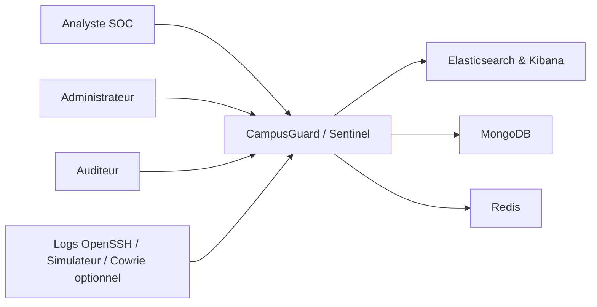
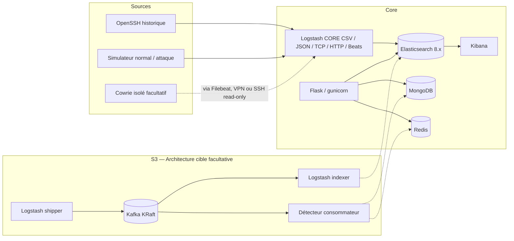
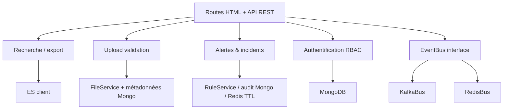
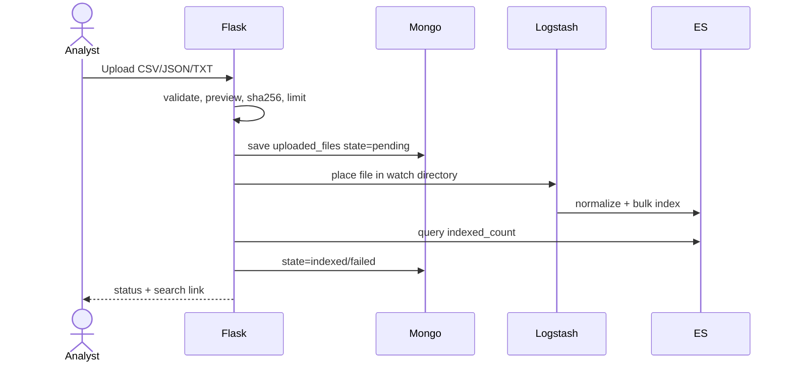
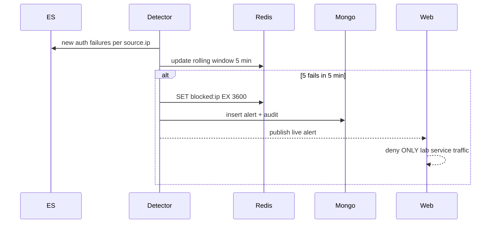
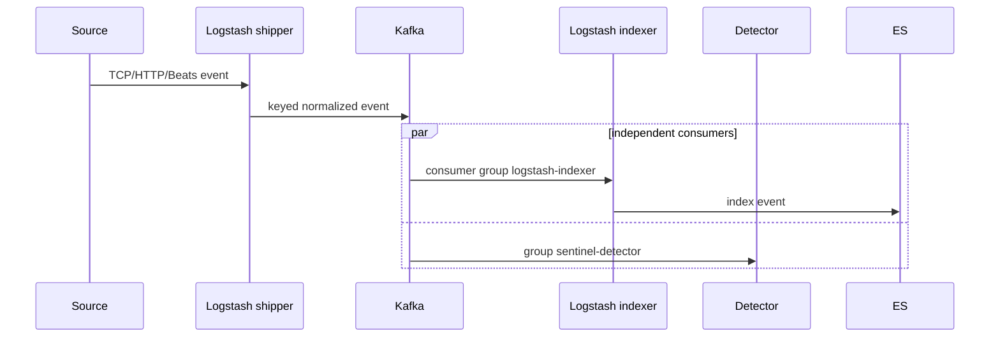

# Architecture globale — CampusGuard / Sentinel (S1)

## Source de vérité et périmètre

Architecture cible inspirée du schéma fourni `sentinel_architecture_globale_v2.png` : Security Data Sources → ingestion shipper (sources directes, Filebeat, TCP/HTTP) → Kafka → indexer → Elasticsearch/Kibana ; Redis + MongoDB servent respectivement à l'état rapide et aux données métier ; Flask accueille les vues et le middleware de laboratoire ; workers de détection/SOAR en phases futures. **S1 : CORE sans Kafka sur le trajet de données ; STREAM est un squelette expérimental.**

## 1. C4 niveau 1 — Contexte

## 2. C4 niveau 2 — Conteneurs

## 3. Flux temps réel cible et responsabilités

- ES = documents d'événements, recherche, agrégations, historique analytique.
- MongoDB = utilisateurs, fichiers, alertes, incidents, requêtes sauvegardées, audit, tableaux personnalisés. Stocker références vers IDs ES, pas duplicata intégral des logs.
- Redis = cache ES, sessions, tokens de rate-limiting, compteurs fenêtre, blocklist TTL, événements légers et bus de repli. Redis Pub/Sub seul n'est pas durable ; l'adaptateur Redis utilise aussi Streams pour limiter les pertes et le documente explicitement.
- Kafka = tampon/rejeu, topics métiers, ordre par clé IP à l'intérieur d'une partition, consommateurs indépendants ; désactivé dans CORE. 24 h rétention initiale ; latence à mesurer.

## 4. C4 niveau 3 — modules Flask cibles

S1 fournit `Flask /health /ready` et interface EventBus, pas les modules ci-dessus en production.

## 5. Modèle Elasticsearch et conventions

Index `logs-*`, 1 shard, 0 replica en laboratoire single-node. Champs pivots : `@timestamp:date`, `event.category/action/outcome:keyword`, `user.name:keyword`, `source.ip:ip`, `source.geo.location:geo_point`, `source.geo.country_iso_code:keyword`, `service.name:keyword`, `log.level:keyword`, `message:text`, `labels.ground_truth:keyword`, `threat.technique.id:keyword`. Ajouter `event.ingested:date` par pipeline (S2). **Le template est dans `ingestion/elasticsearch/logs-template.json`.** Tous les horaires source seront normalisés en UTC ; utiliser l'heure d'ingestion en fallback seulement si un champ de qualité signale l'absence d'heure source.

## 6. Modèles MongoDB — collections et champs

| Collection | Champs structurants | Index à prévoir |
|---|---|---|
| users | `_id`, username, password_hash, role, active, created_at | username unique |
| uploaded_files | `_id`, original_name, sha256, source_type, size_bytes, uploaded_by, state, indexed_count, errors, created_at | (uploaded_by, created_at), sha256 |
| saved_searches | `_id`, user_id, text, filters, created_at | (user_id, created_at) |
| dashboards | `_id`, owner_id, name, layout, widget_configs, visibility, updated_at | owner_id |
| alerts | `_id`, fingerprint, rule_id, ip, user_id, risk_score, status, severity, mitre_ids, created_at, resolved_at | fingerprint, created_at, status |
| incidents | `_id`, alert_ids, assignee, timeline, status, mttr_seconds | status, assignee |
| audit_actions | `_id`, actor_id, action, target, reason, timestamp, before, after | (actor_id,timestamp) |

Les champs de données personnelles sensibles ne doivent pas être copiés sans nécessité.

## 7. Redis — keyspaces et TTL indicatifs

- `sentinel:auth:fail:{ip}` sorted set, fenêtre 300s ; `sentinel:blocked:{ip}` clé TTL 3600s ; `sentinel:cache:search:{sha256}` TTL 60s ; `sentinel:reputation:{ip}` TTL 86400s ; `sentinel:session:{id}` TTL configurable ; `sentinel:logs.auth` Redis Stream borné ; `sentinel:live:alerts` canal Pub/Sub.
- En S1, seule la façade `RedisBus` et ses tests unitaires sont fournis.

## 8. Séquences

### Importation / recherche (S2)

### Détection et blocage labo (S4–S5)

### Streaming cible (S3+)

## 9. Déploiement, sécurité et supervision

`docker-compose.yml` définit un pont `sentinel`, volumes pour ES/Mongo/Redis, limites RAM et healthchecks. Ports de labo liés à `127.0.0.1` ; ES 8.x sécurité volontairement désactivée dans DEV : **ne jamais utiliser cette configuration en production ou la rendre accessible sur Internet.** Kafka en profil `stream`. Cowrie sur un VPS séparé si disponible, pas sur le LAN de l'école. Les authentifications et sessions arriveront S2. `docker stats` + `/ready` + `/_cluster/health` sont les probes S1 ; logs JSON applicatifs structurés et CI arriveront ensuite.

## 10. Hypothèses et écarts documentés

La documentation du prompt cite 655k lignes OpenSSH, nombre à confirmer sur le corpus téléchargé. Le schéma fourni présente un flux Kafka ; son rôle dans CORE est délibérément repoussé pour la mémoire locale. Le chemin Kafka–indexer–détecteur n'est pas câblé en S1. L'ingestion de vrais logs OpenSSH nécessite un parseur grok spécifique après inspection d'un extrait réel ; elle ne doit **pas** être considérée opérationnelle à ce stade. La conformité de chaque conteneur doit être vérifiée par lancement Docker réel.
