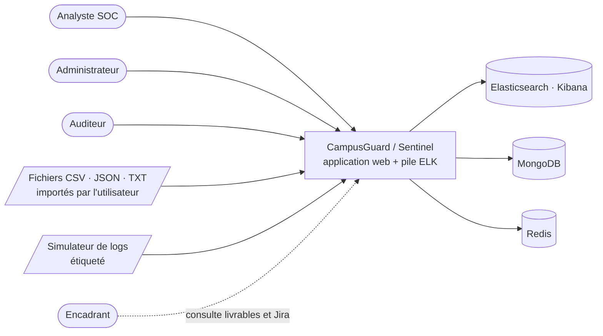
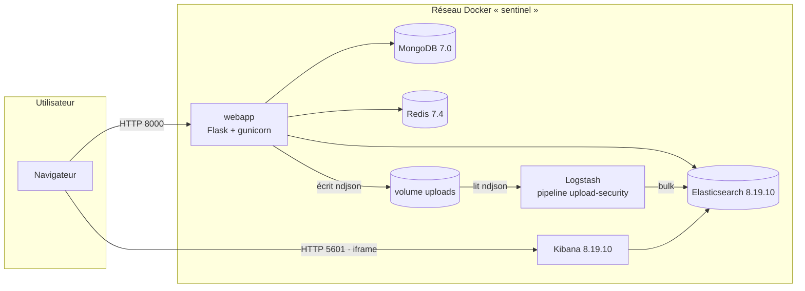
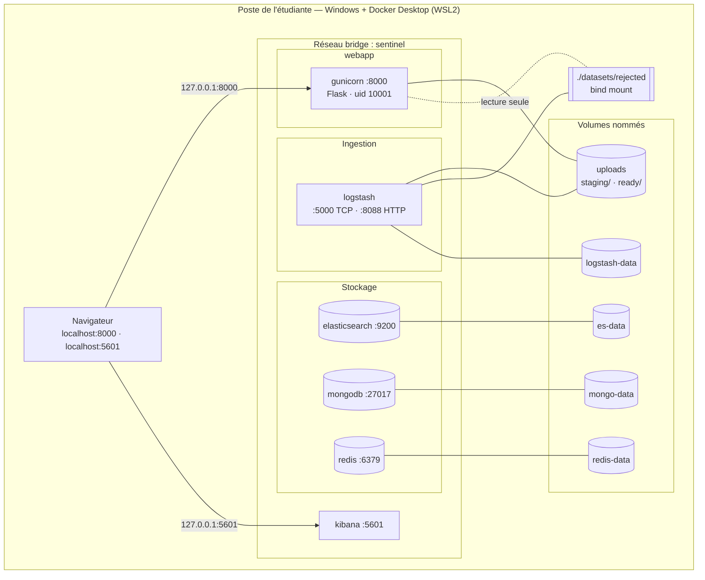
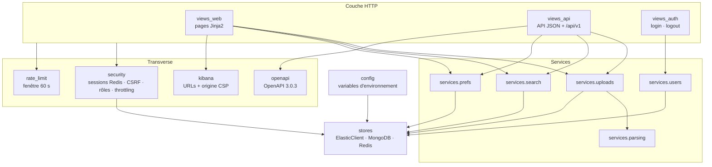
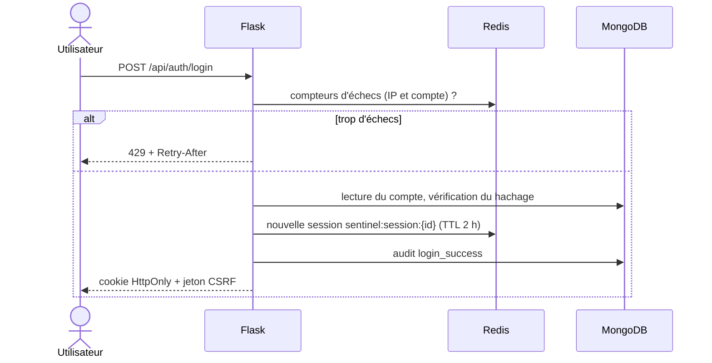
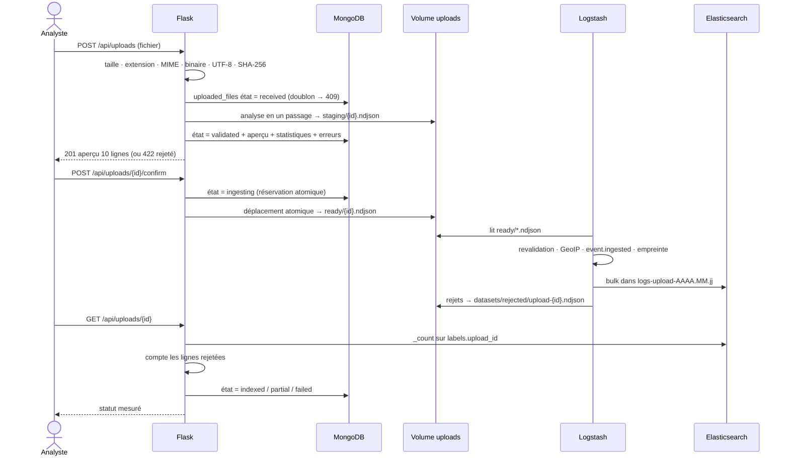
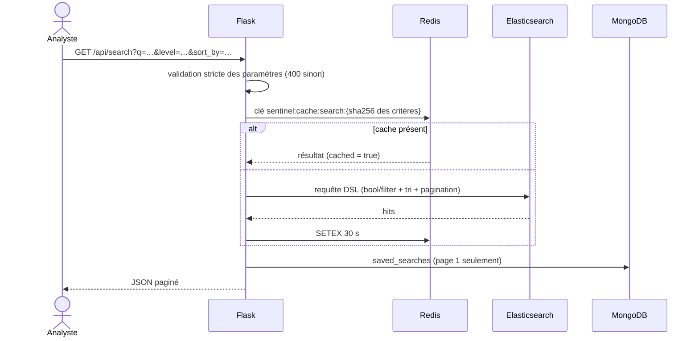
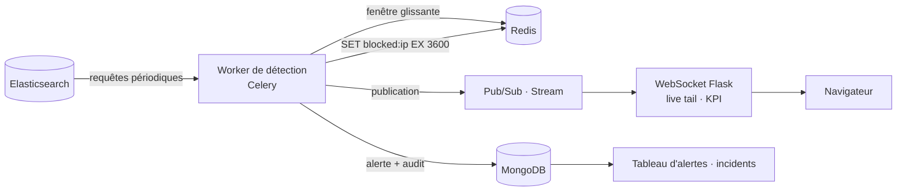

# CampusGuard / Sentinel — Architecture technique

**Version 1.0 — 6 novembre 2026** · Auteure : Syrine Maaref (ITBS) · Encadrant : Mohamed Najeh Issaoui

> **Statut.** Cette architecture décrit ce qui est **réalisé** (S1–S3) et, dans des blocs clairement marqués *Prévu*, ce qui relève de S4–S6. Le code et les tests décrits existent dans le dépôt ; la vérification sur la pile Docker réelle est conditionnée par l'exécution de `scripts/verify_s2.py` et `scripts/verify_s3.py` (voir §14).

## 1. Principes directeurs

1. **Un rôle par technologie.** Elasticsearch stocke et recherche les événements ; MongoDB porte les données métier ; Redis porte l'état rapide et éphémère ; Logstash est l'unique chemin d'indexation ; Flask orchestre.
2. **Ne jamais présenter une intention comme un fait.** Le statut d'un import est *mesuré* (comptage Elasticsearch), pas déduit d'un code HTTP.
3. **Défense en profondeur sur les entrées.** L'application valide et normalise ; Logstash revalide ; Elasticsearch applique un mapping strict (`dynamic: false`).
4. **Sobriété.** Machine cible de 12 Go : une seule instance par service, limites mémoire par conteneur, Kafka désactivé par défaut.
5. **Reproductibilité.** Versions figées, `docker compose up`, aucun secret dans git.
6. **Local d'abord.** Tous les ports sont publiés sur `127.0.0.1` ; la sécurité d'Elasticsearch est désactivée *uniquement* parce que la pile ne sort pas de la machine.

## 2. Contexte (C4 niveau 1)



## 3. Conteneurs (C4 niveau 2) et inventaire



| Service | Image | Rôle | Limite mém. | Port (127.0.0.1) | Persistance |
|---|---|---|---|---|---|
| `elasticsearch` | elasticsearch:8.19.10 | index des événements (nœud unique, 1 shard, 0 réplique, tas 768 Mo) | 1 536 Mo | 9200 | `es-data` |
| `elasticsearch-init` | idem | applique le template d'index (one-shot) | 128 Mo | — | — |
| `logstash` | logstash:8.19.10 | pipelines `csv-security`, `json-security`, `upload-security` | 768 Mo | 5000 (TCP), 8088 (HTTP) | `logstash-data` (sincedb) |
| `kibana` | kibana:8.19.10 | visualisations, dashboard, Discover | 768 Mo | 5601 | — |
| `kibana-init` | idem | crée la data view puis importe le dashboard (one-shot) | 128 Mo | — | — |
| `mongodb` | mongo:7.0 | utilisateurs, imports, recherches, audit, préférences | 384 Mo | 27017 | `mongo-data` |
| `redis` | redis:7.4-alpine | sessions, cache, compteurs, limitation de débit (AOF, 96 Mo max, LRU) | 192 Mo | 6379 | `redis-data` |
| `uploads-init` | busybox:1.37 | prépare le volume partagé (propriétaire uid 10001) | — | — | `uploads` |
| `webapp` | build local | application Flask (gunicorn 2 workers × 2 threads) | 320 Mo | 8000 | `uploads` |
| `kafka`, `filebeat` | profil `stream` | **Prévu / expérimental**, non démarrés par défaut | 1 024 / 256 Mo | — | — |

Somme des limites des services permanents : ≈ 3,9 Go (hors Docker Desktop et WSL2). Ce sont des **plafonds**, pas des mesures ; la mesure réelle (`docker stats`) est à refaire avec l'application (ticket Jira KAN-14).

## 4. Diagramme de déploiement



Les dépendances `depends_on` imposent l'ordre : `uploads-init` → (`webapp`, `logstash`) ; Elasticsearch, MongoDB et Redis *healthy* → `webapp` ; Elasticsearch *healthy* → `elasticsearch-init`, `kibana` ; Kibana *healthy* → `kibana-init`. Chaque service permanent a un *healthcheck*.

## 5. Composants de l'application Flask (C4 niveau 3)



| Module | Responsabilité |
|---|---|
| `main.py` | fabrique `create_app(config, stores)`, en-têtes de sécurité, limitation de débit, `/health`, `/ready`, commandes `init-db`, `seed-users`, `create-user` |
| `config.py` | configuration lue dans l'environnement (jamais dans git) |
| `stores.py` | client Elasticsearch (HTTP), connexions MongoDB / Redis, création idempotente des index MongoDB |
| `security.py` | sessions serveur dans Redis, jeton CSRF, décorateur de rôles, limitation des tentatives de connexion |
| `services/parsing.py` | analyse CSV / JSON / JSONL / TXT, normalisation UTC et ECS, aperçu, rapport d'erreurs |
| `services/uploads.py` | cycle de vie d'un import et mesure du statut |
| `services/search.py` | construction des requêtes Elasticsearch, cache, facettes, export, statistiques |
| `services/users.py` | comptes, hachage, audit |
| `services/prefs.py` | personnalisation du tableau de bord |
| `kibana.py`, `openapi.py` | constantes et URLs Kibana ; spécification d'API |

L'injection de dépendances par `create_app(config, stores)` permet de tester toute l'application avec des services simulés (MongoDB → `mongomock`, Redis → `fakeredis`, Elasticsearch → faux client) sans réseau.

## 6. Flux principaux

### 6.1 Authentification et session



Le cookie ne contient qu'un identifiant opaque de 43 caractères ; l'état de session est dans Redis. L'identifiant est **renouvelé** à la connexion (anti-fixation). Les requêtes `POST`/`PUT`/`DELETE` exigent l'en-tête `X-CSRF-Token`. Un compte inexistant déclenche un calcul de hachage factice pour égaliser les temps de réponse.

### 6.2 Import, validation, ingestion



Détails de conception : la réservation `received → ingesting` est atomique (une seule confirmation possible) ; le déplacement vers `ready/` est un renommage atomique pour que Logstash ne lise jamais un fichier partiel ; l'identifiant de document est l'empreinte SHA-256 de (`upload_id`, numéro de ligne), donc relire un fichier ne crée pas de doublon ; un import resté en `ingesting` plus de 300 s reçoit l'indicateur `stalled` sans être déclaré en échec.

### 6.3 Recherche



Le texte libre utilise `simple_query_string` (opérateur AND) ; les filtres sont placés en contexte `filter` (non scorés, mis en cache par Elasticsearch) ; la fenêtre de pagination est limitée à 10 000 résultats ; l'export CSV réutilise la même construction de requête avec un plafond configurable.

### 6.4 Dashboard Kibana intégré

Au démarrage, `kibana-init` crée la data view `campusguard-logs` (`logs-*`, champ temps `@timestamp`) puis importe `ingestion/kibana/sentinel-dashboard.ndjson` (`POST /api/saved_objects/_import?overwrite=true`). La page `/kibana` de l'application affiche le dashboard dans un `<iframe>`. Pour que cela fonctionne : Kibana est lancé avec `SERVER_SECURITYRESPONSEHEADERS_DISABLEEMBEDDING=false` et la CSP de l'application ajoute `frame-src <origine de KIBANA_PUBLIC_URL>` (et uniquement celle-ci) ; `frame-ancestors 'none'` reste actif pour toutes les pages de l'application.

## 7. Pipeline Logstash `upload-security`

| Étape | Traitement | En cas d'échec |
|---|---|---|
| Entrée | `file` en mode lecture sur `ready/*.ndjson`, codec JSON, `sincedb` persistant | — |
| Contrôle de types (Ruby) | `timestamp`, `message` texte ; objets `source`, `user`, `event`, `log`, `service`, `destination`, `labels` ; IP texte ; port entier 1–65535 ; numéro de ligne entier > 0 ; `upload_id` = 32 caractères hexadécimaux ; champs `event.*`, `log.level`, `service.name` texte | tag `_invalid_field_type` → `upload-unknown.ndjson` (l'identifiant n'est pas fiable, il ne sert jamais à construire un nom de fichier) |
| Date | `timestamp` ISO 8601 → `@timestamp` | `_bad_timestamp` → rejets de l'import |
| Valeurs | IP (grok `%{IP}`), `event.outcome` ∈ {success, failure, unknown}, `event.action` (alphanumérique), `log.level` ∈ {DEBUG…CRITICAL} | tags `_invalid_*` → rejets de l'import |
| Enrichissement | suppression de toute géo fournie par le fichier, GeoIP sur `source.ip`, `event.ingested` en UTC | `_geoip_lookup_failure` (document indexé sans géo) |
| Identifiant | empreinte SHA-256 de (`labels.upload_id`, `log.origin.file.line`) | — |
| Sortie | Elasticsearch `logs-upload-%{+YYYY.MM.dd}`, `manage_template => false` ; rejets dans des fichiers NDJSON | — |

Les pipelines `csv-security` et `json-security` (S1) conservent les entrées historiques CSV/HTTP ; leurs rejets vont dans `datasets/rejected/`.

## 8. Modèle Elasticsearch

Index `logs-*` ; modèle d'index dans `ingestion/elasticsearch/logs-template.json`, appliqué par `elasticsearch-init`, avec **`dynamic: false`** : un champ inconnu reste dans `_source` mais n'est ni indexé ni recherchable.

| Champ | Type | Usage |
|---|---|---|
| `@timestamp` | date | heure de l'événement (UTC) ; champ temps de Kibana |
| `event.ingested` | date | heure de réception par la pile |
| `message` | text | recherche plein texte |
| `event.category`, `event.action`, `event.outcome` | keyword | filtres, agrégations (succès/échec) |
| `log.level` | keyword | niveau (DEBUG → CRITICAL) |
| `log.origin.file.name` / `.line` | keyword / integer | provenance d'une ligne dans un fichier |
| `service.name` | keyword | source applicative |
| `user.name` | keyword | compte concerné |
| `source.ip` | ip | filtre exact ou CIDR, agrégation |
| `source.geo.location`, `source.geo.country_iso_code` | geo_point / keyword | géolocalisation (GeoIP) |
| `destination.port` | integer | port visé |
| `labels.upload_id`, `labels.provenance`, `labels.time_mode`, `labels.ground_truth` | keyword | traçabilité : import d'origine, provenance, mode d'horodatage, vérité terrain synthétique |
| `rule.name`, `threat.technique.id` | keyword | réservés à la détection (S4) |

Exemple de document indexé (import CSV) :

```json
{
  "@timestamp": "2026-10-30T13:00:00.000Z",
  "event": {"category": "authentication", "action": "login", "outcome": "failure", "ingested": "2026-11-06T21:40:12.118Z"},
  "log": {"level": "WARNING", "origin": {"file": {"name": "auth.csv", "line": 2}}},
  "service": {"name": "authentication"},
  "user": {"name": "alice"},
  "source": {"ip": "203.0.113.5"},
  "message": "Failed password",
  "labels": {"upload_id": "9e659fa7ea3d4088a03d27e4edc4f499", "provenance": "upload", "time_mode": "source"}
}
```

## 9. Modèle MongoDB

Base `sentinel`. Les journaux eux-mêmes ne sont **pas** dupliqués : MongoDB ne stocke que les données métier et des références.

| Collection | Contenu | Index |
|---|---|---|
| `users` | `username`, `password_hash` (scrypt), `role`, `active`, `created_at`, `last_login_at` | `username` unique |
| `uploaded_files` | métadonnées et état d'un import, historique des états, statistiques, aperçu, erreurs | (`uploaded_by`, `created_at`), `sha256` |
| `saved_searches` | critères des recherches d'un utilisateur | (`user_id`, `created_at`) |
| `audit_actions` | qui a fait quoi, sur quoi, depuis quelle IP | (`actor`, `timestamp`), (`action`, `timestamp`) |
| `dashboard_prefs` | blocs affichés par utilisateur | `username` unique |
| `alerts`, `incidents` | **Prévu (S4)** | — |

Exemples réels de documents (valeurs raccourcies) :

```json
// users
{"username": "analyste", "password_hash": "scrypt:32768:8:1$…", "role": "analyst", "active": true,
 "created_at": "2026-11-06T21:40:11Z", "last_login_at": "2026-11-06T21:40:11Z"}

// uploaded_files
{"_id": "9e659fa7ea3d4088a03d27e4edc4f499", "original_name": "auth.csv", "source_type": "csv",
 "sha256": "3160dae3…4895c", "size_bytes": 179, "uploaded_by": "analyste", "state": "validated",
 "state_history": [{"state": "received", "at": "…"}, {"state": "validated", "at": "…"}],
 "indexed_count": 0, "rejected_count": 0,
 "stats": {"total_rows": 2, "valid_rows": 2, "invalid_rows": 0, "blank_lines": 0},
 "columns": ["timestamp", "ip", "user", "outcome", "level", "message"],
 "errors": [], "warnings": [], "preview": {"raw_lines": ["timestamp,ip,…"], "events": ["…"]}}

// saved_searches
{"user_id": "6aee493b…", "username": "analyste", "text": "failed", "filters": {"q": "failed"}, "created_at": "…"}

// audit_actions
{"actor": "analyste", "action": "upload_validated", "target": "9e659fa7…", "reason": null,
 "details": {"name": "auth.csv", "sha256": "3160dae3…"}, "ip": "127.0.0.1", "timestamp": "…"}

// dashboard_prefs
{"username": "analyste", "widgets": {"kpis": true, "timeline": false, "levels": true, "services": true, "imports": true, "searches": true},
 "updated_at": "2026-11-06T22:10:00+00:00"}
```

## 10. Architecture Redis

Redis est volontairement **éphémère** : aucune donnée de référence n'y vit. Toutes les clés applicatives portent un TTL.

| Clé | Type | TTL | Rôle |
|---|---|---|---|
| `sentinel:session:{id}` | chaîne (JSON) | 2 h (configurable) | session serveur |
| `sentinel:login:fail:ip:{ip}` / `…:user:{nom}` | compteur | 300 s | blocage des tentatives (5 échecs) |
| `sentinel:ratelimit:{user\|ip}:{minute}` | compteur | 70 s | limitation d'API (300/min) |
| `sentinel:cache:search:{sha256}` | chaîne (JSON) | 30 s | cache des recherches |
| `sentinel:cache:stats`, `sentinel:cache:facets` | chaîne (JSON) | 30 s | cache du tableau de bord et des filtres |
| `sentinel:blocked:{ip}` | chaîne | 3 600 s | **Prévu (S4)** : liste de blocage de laboratoire |
| `sentinel:logs.auth`, `sentinel:live:alerts` | Stream / Pub-Sub | borné | **Prévu (S5)** : bus de repli temps réel |

Configuration : AOF activée, `maxmemory 96mb`, politique `allkeys-lru`. **Point de vigilance documenté :** sous pression mémoire, cette politique pourrait évincer une clé de session ou de blocage ; avec les volumes du laboratoire (quelques utilisateurs, TTL courts) le risque est faible, mais il devra être revu (`volatile-lru`) avant d'y placer la liste de blocage de S4.

## 11. Sécurité : menaces et mesures

| Menace | Mesure | Preuve |
|---|---|---|
| Force brute sur la connexion | 5 échecs / 300 s par IP et par compte → 429 ; audit | `test_s2_auth.py` |
| Énumération de comptes (temps de réponse) | hachage factice pour un compte inconnu (`users.py`) ; message d'erreur unique | `test_s2_auth.py` (même erreur générique) |
| Fixation de session | identifiant renouvelé à la connexion ; cookie `HttpOnly`, `SameSite=Lax` | `test_s2_auth.py` |
| CSRF | jeton obligatoire sur les méthodes modifiantes | `test_s2_auth.py` |
| XSS | CSP `script-src 'self'; style-src 'self'` (aucun JavaScript ni style en ligne), pas d'`innerHTML` | navigateur : 0 erreur CSP |
| Clickjacking | `X-Frame-Options: DENY`, `frame-ancestors 'none'` ; `frame-src` limité à l'origine Kibana | `test_s3_kibana.py` |
| Fichier malveillant | liste blanche d'extensions, contrôle MIME et binaire, taille maximale, aucune exécution du contenu | `test_s2_uploads.py` |
| Injection de formules (CSV) | cellules préfixées par `'` si elles commencent par `= + - @` | `test_s2_search.py` |
| Injection via nom de fichier | l'identifiant d'import (hexadécimal, 32 caractères) est le seul nom utilisé sur disque ; Logstash n'utilise jamais un identifiant non validé | `test_s2_infra.py` |
| Abus d'API | limitation de débit par utilisateur | `test_s2_api.py` |
| Élévation de privilège | rôles vérifiés côté serveur sur chaque route | `test_s2_auth.py`, `test_s2_uploads.py` |
| Fuite de secrets | variables d'environnement ; `.env` ignoré par git ; mots de passe jamais journalisés | `.env.example` |
| Exposition réseau | ports publiés sur `127.0.0.1` uniquement ; Elasticsearch sans sécurité **réservé au laboratoire** | `docker-compose.yml` |

## 12. Choix techniques et alternatives

| Décision | Alternative écartée | Raison |
|---|---|---|
| Sessions côté serveur dans Redis | JWT sans état | révocation immédiate, rôle jamais lu dans le cookie, démonstration naturelle de Redis |
| Normalisation dans l'application **et** validation dans Logstash | tout dans Logstash (grok) | aperçu et erreurs par ligne avant ingestion ; double barrière |
| Statut d'import mesuré dans Elasticsearch | statut déduit de la réponse HTTP | exigence d'honnêteté : « indexé » doit être vrai |
| Visualisations Kibana générées par script, vérifiées contre le mapping | export manuel depuis l'interface | reproductible, relisible, testable |
| Pas de Kafka dans CORE | pipeline Kafka dès S2 | ≈ 1 Go de RAM économisé ; profil `stream` conservé pour une éventuelle expérience mesurée |
| Pas de Celery avant S4 | worker dès S2 | aucun besoin asynchrone tant que l'alerting n'existe pas |
| `mongomock` / `fakeredis` / faux Elasticsearch en test | conteneurs en test | tests rapides (≈ 20 s) et sans Docker ; compensé par les scripts de vérification sur la pile réelle |
| Chart.js et Swagger UI embarqués localement | CDN | CSP stricte et fonctionnement hors ligne |

## 13. Observabilité, qualité et performances

- **Santé :** `/health` (processus) et `/ready` (Elasticsearch `yellow`/`green`, MongoDB, Redis) ; journal d'audit consultable en base.
- **Tests :** suite `pytest` (184 tests au 6 novembre) couvrant parsing, authentification, upload, recherche, API/OpenAPI, Kibana, préférences, câblage Docker/Logstash. Les services externes y sont simulés.
- **Performances :** non mesurées à ce jour. Garde-fous en place : cache 30 s, fenêtre de pagination 10 000, plafond d'export, taille maximale d'import 10 Mo. La campagne de charge est prévue en S6 ; **aucune valeur n'est annoncée avant mesure.**

## 14. Vérification sur la pile réelle

| Script | Ce qu'il prouve | État |
|---|---|---|
| `scripts/verify_core.py` | socle CORE : ELK, MongoDB, Redis, Flask | exécuté le 31 oct., 8/8 |
| `scripts/verify_s2.py` | login → upload → validation → Logstash → Elasticsearch → statut → recherche → export → détail | **à exécuter** (18 contrôles) |
| `scripts/verify_s3.py` | objets Kibana présents et reliés, export puis réimport, intégration en iframe, champs présents dans le mapping réel | **à exécuter** |

## 15. Évolutions prévues (non implémentées)



- **S4 (module G)** : éditeur de règles, worker Celery, déduplication et cooldown, notifications e-mail/webhook, incidents, blocage d'IP de laboratoire (TTL Redis, audit) — jamais de règle de pare-feu du poste.
- **S5 (module H)** : flux continu, WebSocket avec reconnexion, KPI en direct, mesure de latence, rapport mensuel.
- **S6** : comparaison règles / Isolation Forest, TF-IDF / MiniLM, tests de charge, sécurité et reprise.

## 16. Hypothèses et écarts documentés

- Les timestamps sans fuseau sont supposés UTC (avertissement dans le rapport de validation).
- Les motifs `sshd` du parseur de texte sont heuristiques et non validés sur un corpus réel complet ; l'échantillon Loghub OpenSSH reste à intégrer et à mesurer.
- Le nombre de lignes du corpus OpenSSH (≈ 655 000 annoncées) est à confirmer sur le fichier téléchargé.
- Les objets Kibana sont écrits au format « visualisation classique » (agrégations) pour sa stabilité ; leur import n'a pas encore été exécuté sur un Kibana réel (voir `verify_s3.py`).
- Le schéma `sentinel_architecture_globale_v2.png` prévoit Kafka ; son rôle est repoussé volontairement (R1 mémoire).
